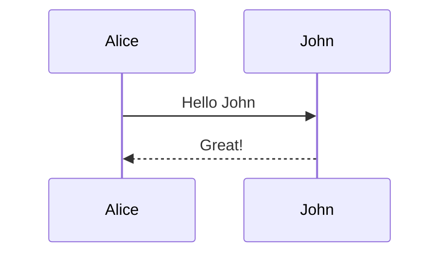

# deckle.nvim

Preview de Markdown renderizado **dentro do Neovim**, num buffer separado e
somente-leitura, ao lado do fonte. Sem browser, sem servidor web, sem webview.

> **deckle** — na fabricação artesanal de papel, é a moldura removível que assenta sobre a
> forma e define as bordas da folha. A polpa disforme entra; a folha formada sai.

- Títulos, parágrafos com wrap por largura de display (emoji e CJK incluídos), listas
  aninhadas e de tarefa, citações, regras, tabelas alinhadas e blocos de código coloridos
  pelo treesitter.
- **Diagramas Mermaid como arte de texto**, em qualquer terminal (tty, ssh, tmux), com um
  binário opcional em Rust. Sem Node, sem Chromium.
- O cursor do fonte e o do preview se seguem.
- Imagens PNG de verdade em kitty e ghostty; nos demais terminais, o texto alternativo.
- Zero dependência obrigatória além do Neovim 0.11: os parsers de Markdown vêm do core.
- Se algo opcional falta, só aquela feature degrada. Um diagrama malformado nunca derruba a
  sessão.

## Como fica

Este Markdown:

````markdown
# deckle.nvim

Preview de **Markdown** dentro do Neovim, num buffer *somente-leitura*
ao lado do fonte. Sem browser, sem servidor, sem webview.

- [x] títulos, listas, citações e `código`
- [x] tabelas alinhadas, com 日本語 e 😀
- [ ] o seu diagrama aqui

| camada | mermaid | imagens |
|:-------|:-------:|--------:|
| 0      | código  |     alt |
| 1      | arte    |     alt |
| 2      | arte    |  imagem |


````

vira isto no preview. É a saída real do render, numa janela de 60 colunas, com o binário
nativo (a suíte confere que esta captura não envelheceu):

```
deckle.nvim
═══════════

Preview de Markdown dentro do Neovim, num buffer
somente-leitura ao lado do fonte. Sem browser, sem servidor,
sem webview.

☑ títulos, listas, citações e código
☑ tabelas alinhadas, com 日本語 e 😀
☐ o seu diagrama aqui

┌────────┬─────────┬─────────┐
│ camada │ mermaid │ imagens │
├────────┼─────────┼─────────┤
│ 0      │ código  │     alt │
│ 1      │  arte   │     alt │
│ 2      │  arte   │  imagem │
└────────┴─────────┴─────────┘

┌───────┐     ┌──────┐
│ Alice │     │ John │
└───┬───┘     └───┬──┘
    │             │
    │ Hello John  │
    ├────────────►│
    │             │
    │ Great!      │
    │◄┈┈┈┈┈┈┈┈┈┈┈┈┤
    │             │
```

No terminal há também cor: títulos, ênfases, código inline, links e a sintaxe dos blocos de
código. O arquivo [`examples/showcase.md`](examples/showcase.md) exercita todo tipo de bloco e
serve de teste manual.

## Requisitos

- **Neovim 0.11.0 ou mais novo.** É a única versão medida (ver
  [ADR-0005](docs/adr/0005-piso-neovim-0-11.md)).
- Nada mais para o preview de Markdown. O binário nativo (Mermaid), um parser treesitter por
  linguagem (cor nos blocos de código) e um terminal kitty ou ghostty (imagens) são opcionais.

## Instalação

### lazy.nvim

```lua
{
  "samuka7abr/deckle.nvim",
  cmd = "Deckle",
  -- Baixa o binário da release. Alternativa, que compila na hora e precisa de cargo e make:
  --   build = "make native",
  build = ":Deckle install",
  opts = {},
}
```

### packer.nvim

```lua
use({
  "samuka7abr/deckle.nvim",
  cmd = "Deckle",
  run = ":Deckle install", -- ou: run = "make native"
  config = function()
    require("deckle").setup()
  end,
})
```

`setup()` é opcional: sem ele valem os valores de fábrica.

### O binário nativo

`:Deckle install` (o `build` acima) segue três degraus, e o plugin funciona em qualquer um deles:

1. baixa `deckle_native-<alvo>.<ext>` da release `v<versão>` do GitHub (via `curl`), confere o
   SHA-256 do arquivo `.sha256` ao lado e instala;
2. se não há binário para a plataforma, nem rede, nem a release ainda publicada, roda
   `cargo build --release` no próprio plugin. O `rustup` baixa a toolchain 1.95 sozinho, a
   partir do `rust-toolchain.toml`, e o `Cargo.lock` versionado mantém o merman na versão
   pinada;
3. se as duas falham, fica na camada 0: uma linha discreta no `:messages` e o motivo no
   `:checkhealth deckle`. Nenhum erro.

**Checksum errado é a exceção:** a instalação aborta e **não** tenta o cargo, porque um
binário que não bate com o hash publicado é um problema de integridade, não "não havia
binário". O hash vem do mesmo lugar que o binário, então isto protege de download corrompido
e de CDN com arquivo trocado, não de um repositório comprometido; não é assinatura.

O comando é assíncrono, e o binário só é carregado na próxima sessão: **reinicie o Neovim**.
Sem editor aberto (CI, Nix):

```sh
nvim --headless -c 'lua require("deckle.install").install(nil, function() vim.cmd("qa") end)'
```

Ele fica em `stdpath("data")/deckle/` (`~/.local/share/nvim/deckle/` no Linux), com um
`install.json` dizendo de onde veio (`release` ou `build`), para qual versão do plugin e o
SHA-256. Não fica dentro do diretório do plugin, porque o gerenciador o apaga e o recria
(`lazy clean`, reinstalação) ou o deixa somente-leitura (Nix). O custo é que atualizar o plugin
não atualiza o binário: um binário de outra versão conta como ausente, e o `build` do lazy.nvim
roda `:Deckle install` de novo sozinho. O `make native` é o caminho de quem desenvolve: deixa
`lua/deckle_native.<ext>` dentro do plugin, que tem precedência.

| Alvo | Arquivo na release | Instalado como |
|---|---|---|
| `x86_64-unknown-linux-gnu` | `deckle_native-x86_64-unknown-linux-gnu.so` | `deckle_native.so` |
| `aarch64-unknown-linux-gnu` | `deckle_native-aarch64-unknown-linux-gnu.so` | `deckle_native.so` |
| `x86_64-apple-darwin` | `deckle_native-x86_64-apple-darwin.dylib` | `deckle_native.so` |
| `aarch64-apple-darwin` | `deckle_native-aarch64-apple-darwin.dylib` | `deckle_native.so` |
| `x86_64-pc-windows-msvc` | `deckle_native-x86_64-pc-windows-msvc.dll` | `deckle_native.dll` |
| `aarch64-pc-windows-msvc` | `deckle_native-aarch64-pc-windows-msvc.dll` | `deckle_native.dll` |

Linux com musl (Alpine) não tem binário: o `.so` de glibc não carrega lá, e o instalador vai
direto para o cargo.

## Uso

`:Deckle [subcomando]`, sem argumento é `toggle`. O Tab completa.

| Comando | O que faz |
|---|---|
| `:Deckle open` | abre o preview do buffer atual ao lado |
| `:Deckle close` | fecha a janela do preview |
| `:Deckle toggle` | abre ou fecha |
| `:Deckle refresh` | renderiza de novo agora, sem esperar o debounce |
| `:Deckle health` | atalho para `:checkhealth deckle` |
| `:Deckle install` | instala o binário nativo |

O buffer de preview é somente-leitura (`filetype=deckle`). Ele se renderiza de novo, com
debounce, quando o fonte muda e quando a janela é redimensionada. Não edita vendo o render ao
lado no mesmo texto: para isso existem o markview.nvim e o render-markdown.nvim.

## Configuração

Todas as chaves são opcionais. Estes são os valores de fábrica:

```lua
require("deckle").setup({
  split = "vsplit",
  width = nil,
  charset = "auto",
  sync = "cursor",
  debounce_ms = 120,
  native = { enabled = true, path = nil },
  mermaid = { max_src_lines = 200 },
  images = { enabled = "auto", max_height = 20 },
})
```

| Opção | Valores | O que faz |
|---|---|---|
| `split` | `"vsplit"`, `"split"`, `"tab"` | onde a janela de preview abre |
| `width` | inteiro, ou `nil` | largura do texto em células; `nil` é a largura da janela |
| `charset` | `"auto"`, `"unicode"`, `"ascii"` | bordas, marcadores e arte do Mermaid; `"auto"` é `"ascii"` só em `TERM=linux` ou `dumb` |
| `sync` | `"cursor"`, `"off"` | liga a sincronia entre o cursor do fonte e o do preview |
| `debounce_ms` | número >= 0 | espera, em ms, antes de renderizar de novo |
| `native.enabled` | booleano | `false` nunca carrega o binário nativo |
| `native.path` | string, ou `nil` | caminho explícito do binário; se configurado e não carregar, não cai para outro |
| `mermaid.max_src_lines` | inteiro > 0 | acima disso o bloco `mermaid` vira código, com uma nota |
| `images.enabled` | `"auto"`, `true`, `false` | `true` assume o risco de SSH e tmux sem confirmação |
| `images.max_height` | inteiro > 0 | teto, em linhas, de uma imagem |

Uma chave desconhecida é erro, para um typo não virar "não funciona". Os grupos de highlight
(`DeckleH1` a `DeckleH6`, `DeckleCode`, `DeckleQuote`...) têm `default` e são ligados a grupos
padrão, então o seu esquema de cores vence; para trocar um, use `vim.api.nvim_set_hl`. A lista
completa está em `:help deckle-highlights`.

## Camadas de degradação

Cada camada funciona sozinha, e as capacidades são detectadas em tempo de execução. Na dúvida,
a camada mais baixa.

| Camada | Requisito | Mermaid vira | Imagens viram |
|---|---|---|---|
| **0** | só o Neovim | bloco de código | texto alternativo |
| **1** | + o binário `deckle_native` | **arte Unicode ou ASCII** | texto alternativo |
| **2** | + terminal kitty ou ghostty | arte Unicode ou ASCII | **imagem de verdade** |
| 3 | + `mmdc` (não implementada) | | |

A camada 0 já é o preview completo, sem uma linha de Rust. A camada 1 funciona em qualquer
terminal, porque a saída é texto. A camada 3 é só um desenho: nada do plugin depende dela.
`:checkhealth deckle` diz em que camada você está e o que falta para subir.

### Imagens

Um parágrafo que é só `` vira uma imagem de verdade em **kitty e ghostty**,
pelo protocolo do kitty (Unicode placeholders, então a imagem rola junto com o buffer). Só
PNG local. URL, JPEG, SVG, uma imagem no meio do texto ou dentro de um link continuam sendo
`[image: alt]`. iTerm2, WezTerm e sixel são detectados, mas ainda só mostram o texto
alternativo. Dentro do tmux só com `allow-passthrough` ligado, e numa sessão SSH só com
`images.enabled = true`. Nenhum terminal gráfico de verdade abriu uma imagem do deckle ainda;
ver as limitações em `:help deckle-images`.

## Limitações conhecidas

As principais, com o resto em `:help deckle-limitations`:

- Aninhamento acima de 64 níveis de citação e lista faz o documento inteiro cair em texto
  cru, porque o parser de Markdown do Neovim aborta o processo com aninhamento fundo.
- Oito tipos de Mermaid (`gantt`, `gitgraph`, `journey`, `kanban`, `mindmap`, `packet`,
  `timeline`, `treeView`) saem como texto estruturado, e não como desenho. Tipos como `pie`
  caem para código, com uma nota.
- A quebra de linha de CJK não segue a regra de kinsoku: um `。` pode abrir uma linha.
- Nada foi medido numa UI de terminal de verdade: os testes são headless.

## Desenvolvimento

```sh
./scripts/test.sh                        # suíte inteira
./scripts/test.sh tests/test_config.lua  # um arquivo só
```

A primeira execução baixa o [mini.test](https://github.com/echasnovski/mini.nvim) em
`.deps/`. Formatação com `stylua`, lint com `selene` (a CI roda os dois sobre `lua/`,
`plugin/`, `tests/` e `scripts/run.lua`).

Os testes do parser comparam o IR de `tests/fixtures/*.md` com o snapshot ao lado
(`*.lua`). Depois de mudar o IR de propósito, regenere e **revise o diff** antes de commitar:

```sh
DECKLE_UPDATE_SNAPSHOTS=1 ./scripts/test.sh tests/test_parse.lua && stylua tests/
```

A documentação é conferida pela suíte (`tests/test_doc.lua`): o `doc/deckle.txt` carrega com
`:helptags`, toda tag referenciada existe, toda opção de `setup()` e todo grupo de highlight
está documentado, e o bloco de configuração do `:help` e o deste README são iguais aos valores
de fábrica. Mudou uma opção ou um grupo? A suíte diz o que falta documentar.

Componente nativo (Rust 1.95, instalado pelo `rustup` a partir do `rust-toolchain.toml`):

```sh
cargo test                  # lógica pura, sem Neovim: os 14 tipos de diagrama, erros, guardas
make native                 # compila e instala lua/deckle_native.<ext> (falha se o build falhar)
./scripts/test-native.sh    # make native + testes headless no nvim com o .so de verdade
make bench                  # benchmark do flowchart
make check-merman           # falha se o merman resolver para versão diferente da pinada
```

Para mexer no `doc/deckle.txt`: o arquivo é escrito à mão, com linhas de até 78 colunas e a
modeline no fim. Teste com `:helptags doc/` e `:help deckle`.

## Como funciona

Lua faz tudo que encosta no Neovim: treesitter (os parsers vêm do **core**, sem
nvim-treesitter), buffer de preview somente-leitura, extmarks, sincronia de scroll e a
detecção do terminal. Um componente Rust opcional, carregado via `mlua`, cuida só do Mermaid,
com o [`merman`](https://crates.io/crates/merman-ascii), a implementação headless de Mermaid
em Rust que o Zed usa: 14 tipos de diagrama, ~1,4 ms num flowchart típico.

Princípios de projeto: zero dependência obrigatória; capacidades extras são detectadas e
melhoram o resultado, sem que a ausência delas quebre nada; nada pode matar o editor; a
degradação é por feature, não do plugin.

## Documentação

- `:help deckle` ([doc/deckle.txt](doc/deckle.txt)): o manual de uso
- [Arquitetura](docs/architecture.md)
- [Roadmap](docs/roadmap.md)
- [Validação empírica](docs/validation.md): o que foi medido e o que ainda é suposição
- [Exemplo para teste manual](examples/showcase.md)
- Decisões (ADR):
  - [0001 — `mlua` em vez de `nvim-oxi`](docs/adr/0001-mlua-sobre-nvim-oxi.md)
  - [0002 — `merman-ascii` em vez de implementar Mermaid do zero](docs/adr/0002-merman-sobre-implementacao-propria.md)
  - [0003 — buffer separado, não decoração in-place](docs/adr/0003-buffer-separado.md)
  - [0004 — degradação em camadas](docs/adr/0004-degradacao-em-camadas.md)
  - [0005 — piso de versão do Neovim em 0.11.0](docs/adr/0005-piso-neovim-0-11.md)
