# Mermaid no deckle

Showcase só de Mermaid: pelo menos um diagrama grande de cada um dos 14 tipos que o
renderer de texto cobre (`deckle_native.supported_types()`), usando a sintaxe quase toda.
Abra com `:Deckle open`. É também um teste: o `cargo test` renderiza cada bloco daqui, e o
job `native` abre este arquivo no preview e exige que nenhum bloco degrade, com a única
exceção do `pie` da última seção. Voltar ao [showcase geral](showcase.md).

Estilo e cor (`classDef`, `style`, `linkStyle`, `rect rgb(...)`, `box`) viram cor no preview
em flowchart, state e sequence quando `mermaid.colors = true` (o padrão). Em class o merman
não emite cor. Em nenhum caso o estilo pode quebrar ou degradar o desenho.

## Índice

- [flowchart](#flowchart): formas de nó, arestas, subgraphs aninhados, 50+ nós, `RL` e `BT`
- [sequence](#sequence), [class](#class), [state](#state), [er](#er)
- [gantt](#gantt), [gitgraph](#gitgraph), [journey](#journey), [kanban](#kanban)
- [mindmap](#mindmap), [packet](#packet), [timeline](#timeline), [treeView](#treeview),
  [xychart](#xychart)
- [README do ILZA](#readme-do-ilza): dois diagramas reais, um bug report
- [Degradação esperada](#degradação-esperada)

## flowchart

### Todas as formas de nó e todas as arestas

As quatorze formas clássicas, numa cadeia que usa os oito tipos de aresta (`-->`, `---`,
`-.->`, `==>`, `--o`, `--x`, `<-->`, `~~~`), com e sem rótulo, mais uma aresta de volta. Os
traços alternam ao longo da cadeia, mas nenhum se cruza: o layout de texto do merman não
desenha duas arestas de traços diferentes que se cruzam (ver `:help deckle-limitations`).

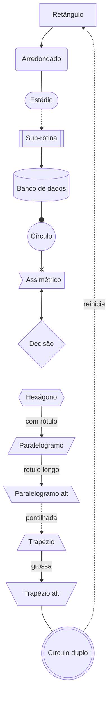

### Pipeline de CI/CD: subgraphs aninhados com direção, estilo e cliques

Subgraphs aninhados, `direction` diferente em cada um, `classDef`, `class`, `:::`, `style`,
`linkStyle` com cores e `click` (que o desenho ignora). Rótulos com emoji, acento, CJK e `\n`.

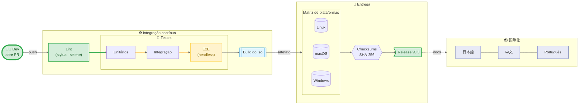

### Plataforma com mais de 50 nós

Cinquenta e quatro nós em nove camadas, 72 arestas que se cruzam entre camadas, nove
`classDef`, uma forma de nó por camada. É o caso de estresse do layout: gasta cerca de 2
milhões das unidades de trabalho que o merman permite (o deckle sobe o teto para 4 milhões).
Sem subgraphs de propósito: aresta que pula uma camada de subgraph é a que o merman não roteia
(o diagrama do ILZA, mais abaixo, é o exemplo).

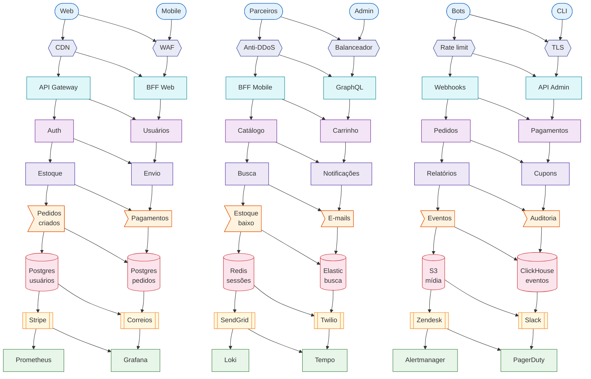

### Direção `RL`

Da direita para a esquerda, com os rótulos de aresta em português e uma decisão.

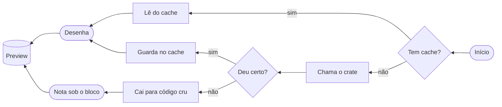

### Direção `BT`

De baixo para cima: uma pilha de camadas, cada uma apoiada na anterior.

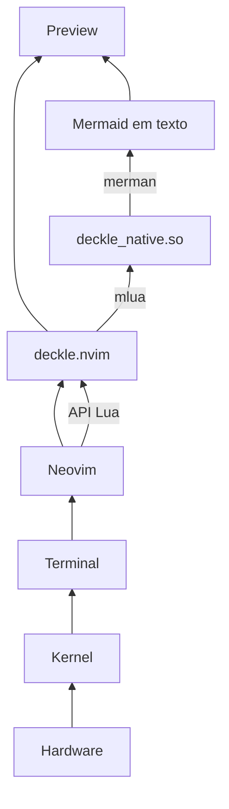

### Sintaxe nova de forma: `@{ shape: ... }`

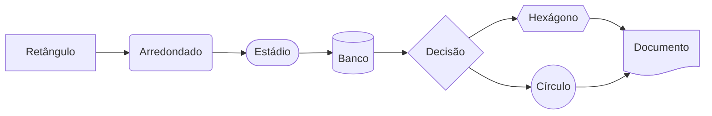

## sequence

Todos os tipos de seta, `autonumber`, `box`, `create`/`destroy`, ativação com `+`/`-`,
`loop`/`alt`/`else`/`opt`/`par`/`and`/`critical`/`option`/`break`, `rect` e as três
posições de nota.

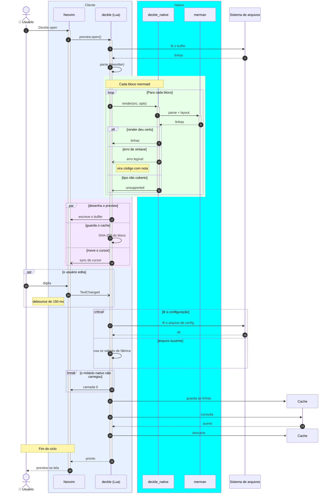

## class

Genéricos, visibilidade (`+ - # ~`), métodos abstratos (`*`) e estáticos (`$`), anotações,
todos os tipos de relação com cardinalidade e rótulo, `namespace`, notas e estilo.

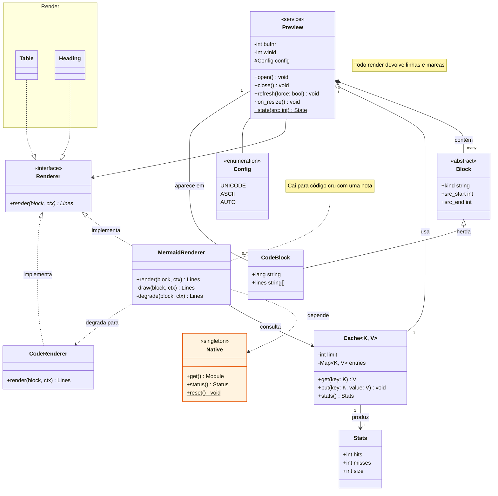

## state

`[*]`, `<<choice>>`, `<<fork>>`, `<<join>>`, notas e `classDef`, numa máquina de 14 estados.
O segundo diagrama é um estado composto. O layout de texto do merman só desenha o composto
na forma mais simples (entra por um estado, tem `[*]` no começo e no fim, sai para `[*]`):
composto com aresta de volta, composto dentro de composto e concorrência com `--` ficam de
fora (ver `:help deckle-limitations`).

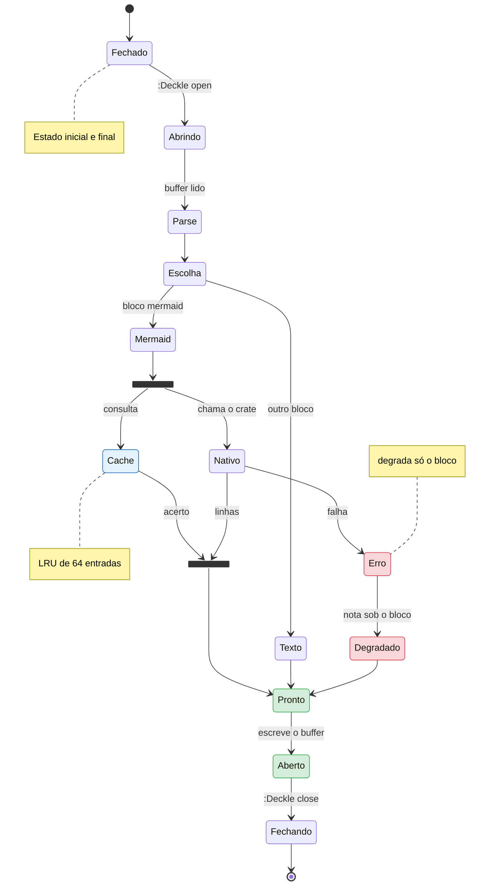

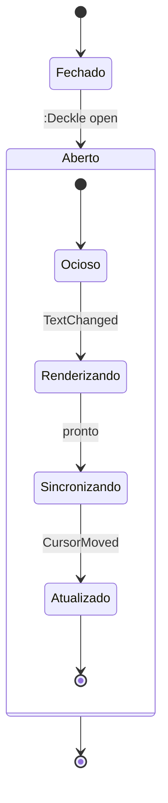

## er

Dez entidades, todas as cardinalidades, atributos com `PK`, `FK`, `UK` e comentários.

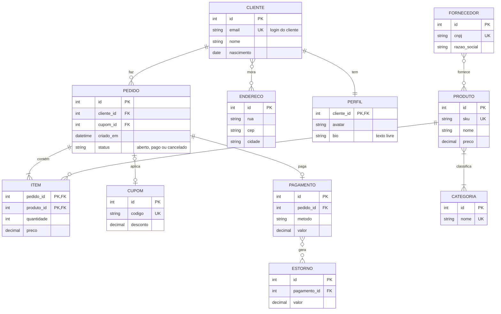

## gantt

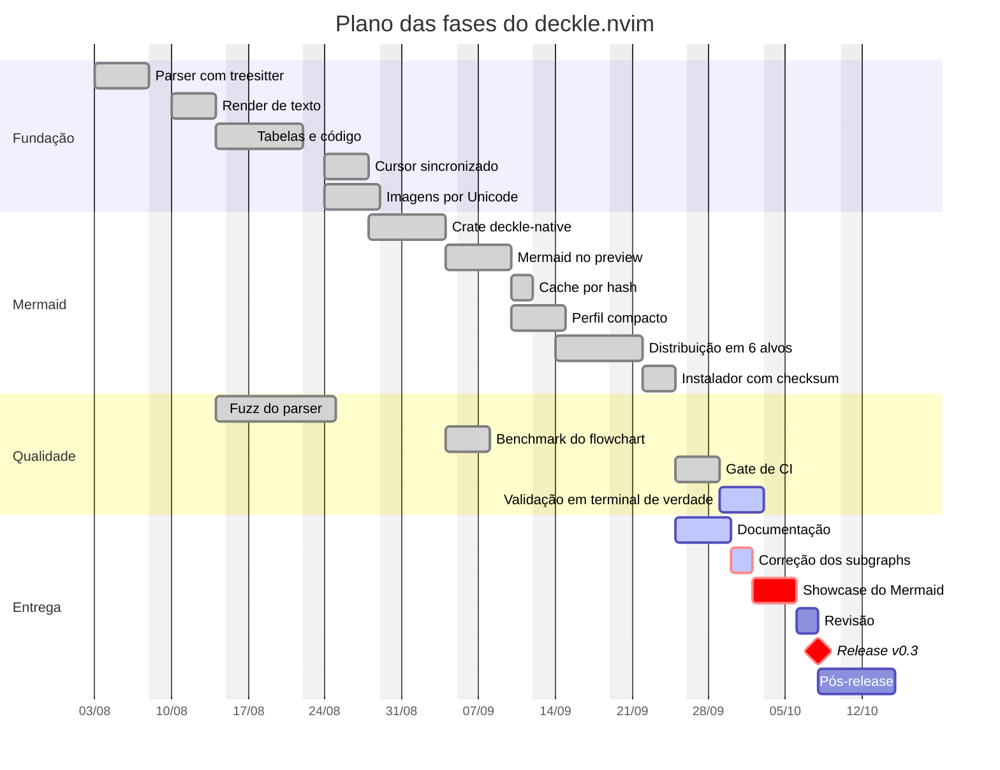

## gitgraph

Branches, merges, `cherry-pick`, tags e commits de tipos diferentes.

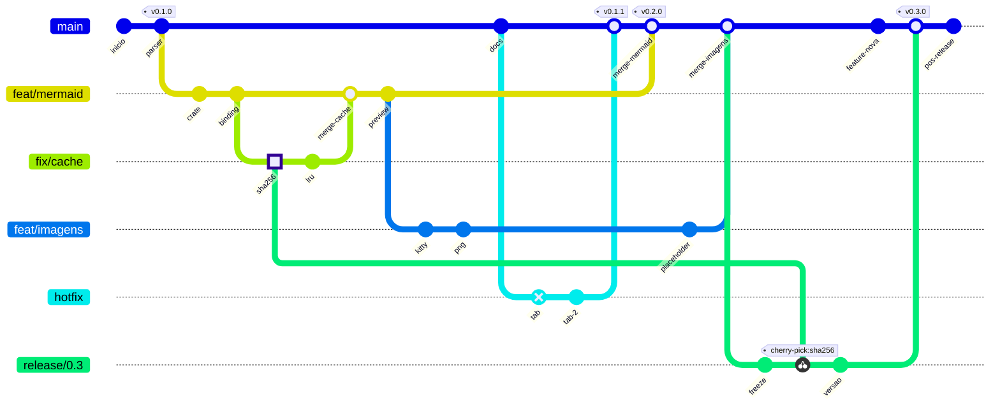

## journey

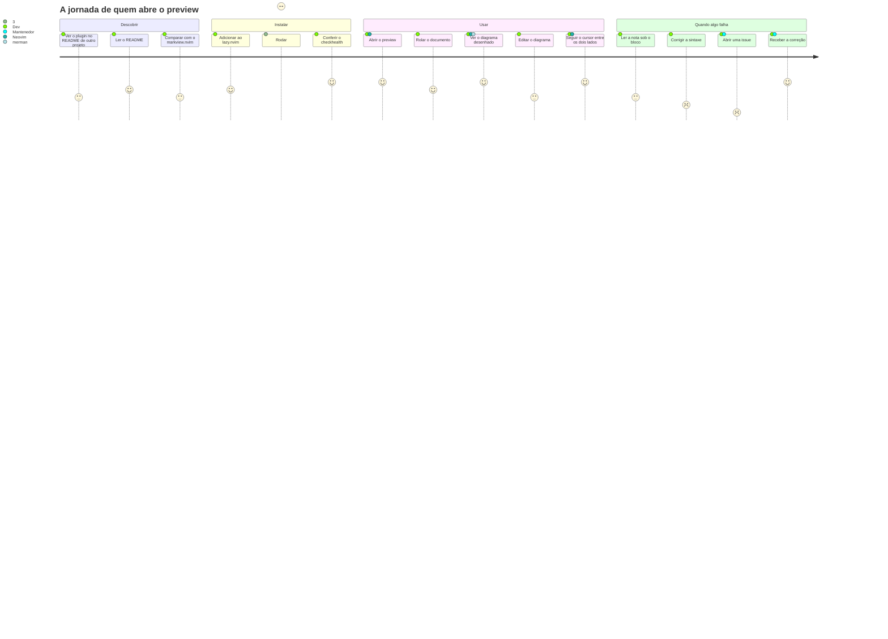

## kanban

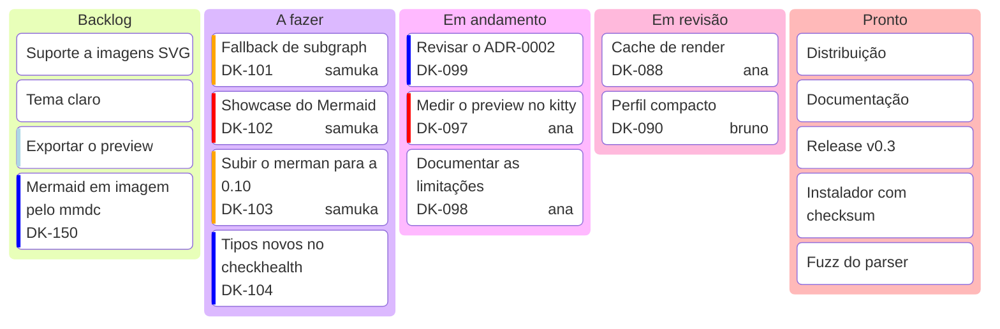

## mindmap

Formas de nó (`[ ]`, `( )`, `(( ))`, `)) ((`, `) (`, `{{ }}`), ícones e classes.

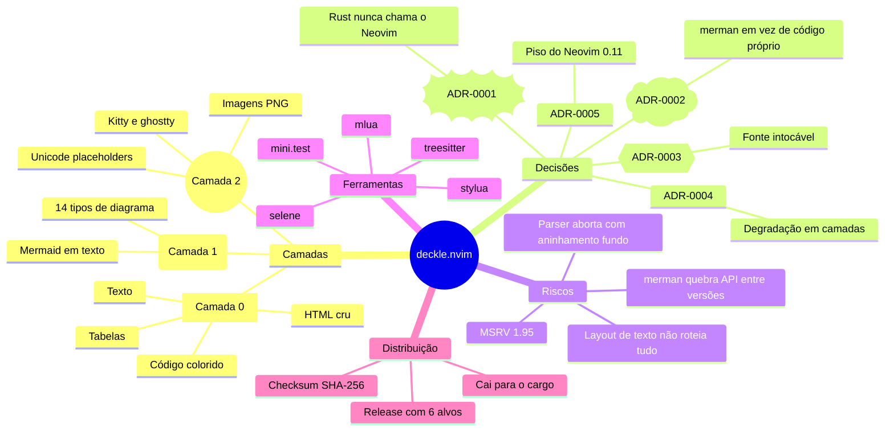

## packet

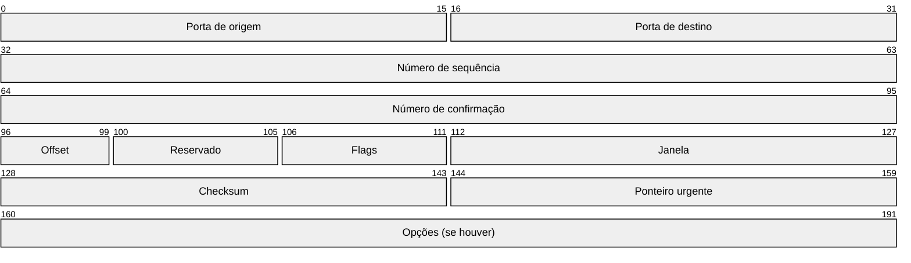

## timeline

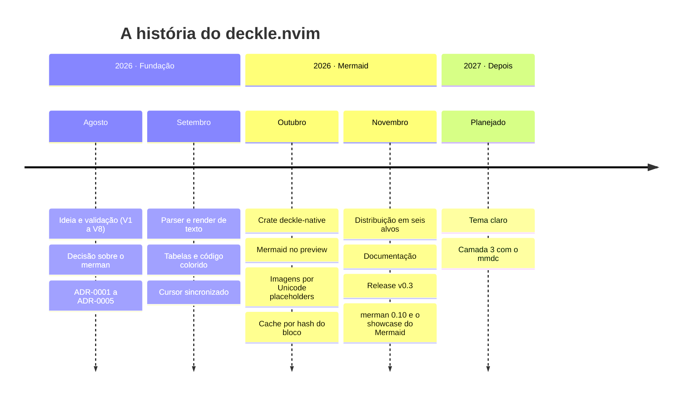

## treeView

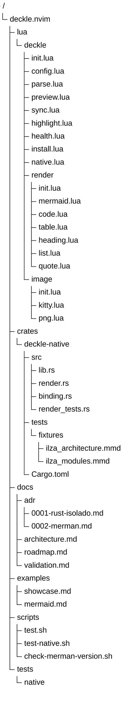

## xychart

Barras e linhas no mesmo gráfico, eixos com rótulo e a orientação horizontal.

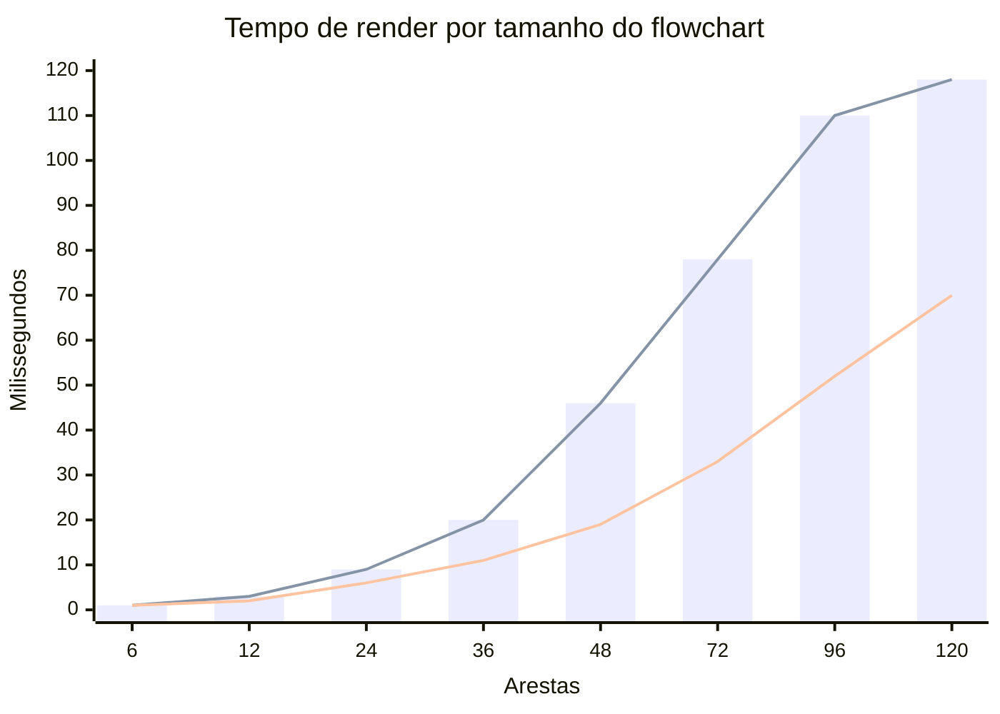

```mermaid
xychart-beta horizontal
    title "Blocos por tipo no showcase"
    x-axis [flowchart, sequence, class, state, er, gantt, gitgraph, journey, kanban, mindmap, packet, timeline, treeView, xy]
    y-axis "Blocos" 0 --> 8
    bar [6, 1, 1, 2, 1, 1, 1, 1, 1, 1, 1, 1, 1, 2]
```

## README do ILZA

Dois diagramas reais, copiados sem alteração do README de um projeto (o bug report que
motivou este arquivo): um `flowchart TB` com subgraphs aninhados e `direction` diferentes e um
`graph LR` com subgraphs. O renderer de texto do merman não consegue rotear as arestas que
cruzam as bordas dos grupos (`routes crossing reserved graph geometry`, `unroutable graph
edges`): antes da correção o preview mostrava só o código e essa nota. Agora o deckle desenha
o grafo **sem as bordas dos grupos** (os nós e as arestas ficam) e diz isso numa linha sob o
desenho. São os dois únicos blocos deste arquivo com esse aviso.

```mermaid
flowchart TB
    subgraph Cliente["🖥️ Cliente"]
        FE["Frontend\n(React / Next.js)"]
    end

    subgraph API["⚡ FastAPI — API REST :8000"]
        direction TB
        HEALTH["/health"]
        CORS["CORS Middleware"]
        RATELIMIT["Rate Limit Middleware"]
        DB_MW["DB Session Middleware"]

        subgraph Modules["Módulos da Aplicação"]
            direction LR
            subgraph AuthMod["🔐 Auth Module"]
                AUTH_CTRL["Auth Controller"]
                AUTH_UC["Use Cases\nLogin · Register\nRefresh · Logout\nGet Me"]
                AUTH_DOMAIN["Domain\nUser · Role\nToken Payload\nRefresh Token"]
                AUTH_INFRA["Infrastructure\nBCrypt Hasher\nJWT Token Service\nUser Repository\nRefresh Token Repo"]
            end

            subgraph PatientsMod["👤 Patients Module"]
                PAT_CTRL["Patients Controller"]
                PAT_UC["Use Cases\nGet · List · Update\nFind by CPF\nFind or Create"]
                PAT_DOMAIN["Domain\nPatient Entity\nCPF · Sex VOs"]
                PAT_INFRA["Infrastructure\nPatient Repository\nPessoa Model"]
            end
        end
    end

    subgraph AI["🧠 Domínio IA (ai/)"]
        direction TB

        ENGINE["TriageEngine\n(ITriageEngine)"]

        subgraph Agents["Agentes"]
            direction LR
            TRIAGE_AG["TriageAgent\n(Protocolo Manchester)"]
            SPEC_AG["SpecialistAgent\n(Anamnese Aprofundada)"]
        end

        subgraph AISupport["Suporte IA"]
            direction LR
            PROMPTS["Prompts\nTriage Instructions\nSpecialist Instructions"]
            GUARDRAIL["OpenAI Guardrail\n+ Rules"]
            SESSION["FileSessionManager\n(ISessionManager)"]
            TOOL["Report Tool\n(IReportTool)"]
        end

        DI["DI Factory\ncreate_triage_engine()"]
    end

    subgraph Temporal["⏱️ Temporal.io"]
        direction LR
        TEMPORAL_SRV["Temporal Server\n:7233"]
        TEMPORAL_UI["Temporal UI\n:8233"]
        WORKER["Temporal Worker\nTriageWorkflow"]
    end

    subgraph Infra["🏗️ Infraestrutura"]
        direction LR
        PG[("PostgreSQL 16\nApp DB\n:5432")]
        PG_TEMP[("PostgreSQL 16\nTemporal DB\n:5433")]
        REDIS[("Redis 7\n:6379")]
    end

    subgraph External["☁️ Serviços Externos"]
        direction LR
        OPENAI["OpenAI API\nGPT-5\nGPT-4.1-mini"]
        S3["AWS S3\nRelatórios PDF"]
    end

    %% ── Fluxo Principal ──
    FE -->|"HTTP/REST"| API
    AUTH_CTRL --> AUTH_UC --> AUTH_DOMAIN
    AUTH_UC --> AUTH_INFRA
    PAT_CTRL --> PAT_UC --> PAT_DOMAIN
    PAT_UC --> PAT_INFRA

    %% ── API → IA ──
    API -->|"Triagem Request"| ENGINE
    ENGINE --> TRIAGE_AG
    TRIAGE_AG -->|"Handoff"| SPEC_AG
    TRIAGE_AG --> PROMPTS
    SPEC_AG --> PROMPTS
    SPEC_AG --> TOOL
    ENGINE --> GUARDRAIL
    ENGINE --> SESSION
    DI -->|"Compõe"| ENGINE

    %% ── Temporal ──
    API -->|"Start Workflow"| TEMPORAL_SRV
    TEMPORAL_SRV --> WORKER
    WORKER -->|"Executa"| ENGINE
    TEMPORAL_SRV --> PG_TEMP
    TEMPORAL_UI --> TEMPORAL_SRV

    %% ── Infra ──
    AUTH_INFRA --> PG
    PAT_INFRA --> PG
    AUTH_INFRA -->|"Rate Limit"| REDIS

    %% ── Externos ──
    TRIAGE_AG -->|"LLM Call"| OPENAI
    SPEC_AG -->|"LLM Call"| OPENAI
    GUARDRAIL -->|"Validação"| OPENAI
    TOOL -->|"Upload PDF"| S3

    %% ── Estilos ──
    classDef clientStyle fill:#e3f2fd,stroke:#1565c0,stroke-width:2px,color:#0d47a1
    classDef apiStyle fill:#fff3e0,stroke:#e65100,stroke-width:2px,color:#bf360c
    classDef aiStyle fill:#f3e5f5,stroke:#6a1b9a,stroke-width:2px,color:#4a148c
    classDef temporalStyle fill:#e8f5e9,stroke:#2e7d32,stroke-width:2px,color:#1b5e20
    classDef infraStyle fill:#fce4ec,stroke:#c62828,stroke-width:2px,color:#b71c1c
    classDef extStyle fill:#fff8e1,stroke:#f57f17,stroke-width:2px,color:#e65100

    class FE clientStyle
    class HEALTH,CORS,RATELIMIT,DB_MW,AUTH_CTRL,AUTH_UC,AUTH_DOMAIN,AUTH_INFRA,PAT_CTRL,PAT_UC,PAT_DOMAIN,PAT_INFRA apiStyle
    class ENGINE,TRIAGE_AG,SPEC_AG,PROMPTS,GUARDRAIL,SESSION,TOOL,DI aiStyle
    class TEMPORAL_SRV,TEMPORAL_UI,WORKER temporalStyle
    class PG,PG_TEMP,REDIS infraStyle
    class OPENAI,S3 extStyle
```

```mermaid
graph LR
    subgraph app["app/"]
        direction TB
        APP_PY["app.py\n(create_app)"]

        subgraph shared["shared/"]
            SETTINGS["Settings"]
            DB_CONN["DB Connection"]
            EXCEPTIONS["Domain Exceptions"]
            MIDDLEWARES["CORS · Rate Limit"]
        end

        subgraph auth["modules/auth/"]
            A_PRES["Presentation\nController · DTOs"]
            A_APP["Application\nUse Cases"]
            A_DOMAIN["Domain\nEntities · VOs · Interfaces"]
            A_INFRA["Infrastructure\nRepositories · Services"]
        end

        subgraph patients["modules/patients/"]
            P_PRES["Presentation\nController · DTOs"]
            P_APP["Application\nUse Cases"]
            P_DOMAIN["Domain\nEntities · VOs · Interfaces"]
            P_INFRA["Infrastructure\nRepositories · Models"]
        end
    end

    subgraph ai["ai/"]
        direction TB
        subgraph core["core/ (Interfaces)"]
            I_ENGINE["ITriageEngine"]
            I_RESPONSE["AgentResponse\nSessionState"]
            BASE_AGENT["BaseAgent\nRawAgentResult"]
        end

        subgraph agents["agents/"]
            TRIAGE["TriageAgent"]
            SPECIALIST["SpecialistAgent"]
            TYPES["Response Types"]
        end

        subgraph support["Suporte"]
            PROMPTS_MOD["prompts/"]
            GUARDRAILS_MOD["guardrails/"]
            SESSION_MOD["session/"]
            TOOLS_MOD["tools/"]
        end

        AI_ENGINE["engine.py\nTriageEngine"]
        AI_DI["di.py\nFactory DI"]

        subgraph workflows["workflows/"]
            WF["TriageWorkflow"]
            WK["Worker"]
        end
    end

    A_PRES --> A_APP --> A_DOMAIN
    A_APP --> A_INFRA
    P_PRES --> P_APP --> P_DOMAIN
    P_APP --> P_INFRA

    AI_DI --> AI_ENGINE
    AI_ENGINE --> TRIAGE
    AI_ENGINE --> SPECIALIST
    TRIAGE --> PROMPTS_MOD
    SPECIALIST --> PROMPTS_MOD
    AI_ENGINE --> GUARDRAILS_MOD
    AI_ENGINE --> SESSION_MOD
    SPECIALIST --> TOOLS_MOD
    WF --> AI_ENGINE

    classDef appColor fill:#fff3e0,stroke:#e65100,color:#bf360c
    classDef aiColor fill:#f3e5f5,stroke:#6a1b9a,color:#4a148c
    classDef coreColor fill:#e8eaf6,stroke:#283593,color:#1a237e

    class APP_PY,SETTINGS,DB_CONN,EXCEPTIONS,MIDDLEWARES,A_PRES,A_APP,A_DOMAIN,A_INFRA,P_PRES,P_APP,P_DOMAIN,P_INFRA appColor
    class TRIAGE,SPECIALIST,TYPES,PROMPTS_MOD,GUARDRAILS_MOD,SESSION_MOD,TOOLS_MOD,AI_ENGINE,AI_DI,WF,WK aiColor
    class I_ENGINE,I_RESPONSE,BASE_AGENT coreColor
```

## Degradação esperada

O renderer de texto não cobre todos os tipos. Um `pie` vira código com uma nota sob a
moldura, e só esse bloco: o resto do arquivo não muda. É o único bloco deste arquivo que
deve degradar.

```mermaid
pie title Cobertura do showcase
    "Tipos desenhados" : 14
    "Tipos que degradam" : 1
```
