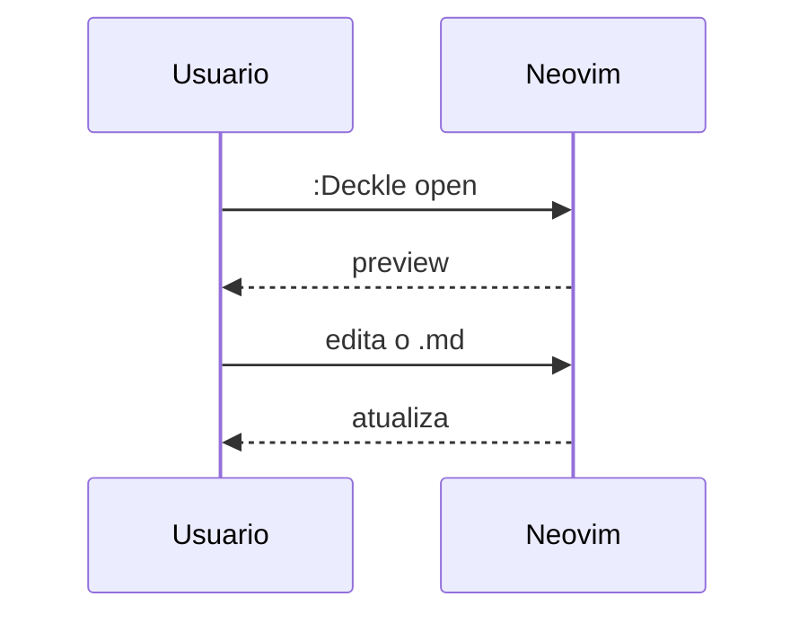
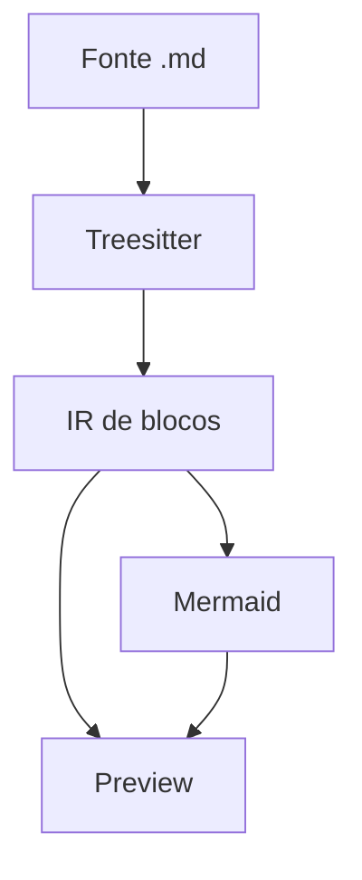
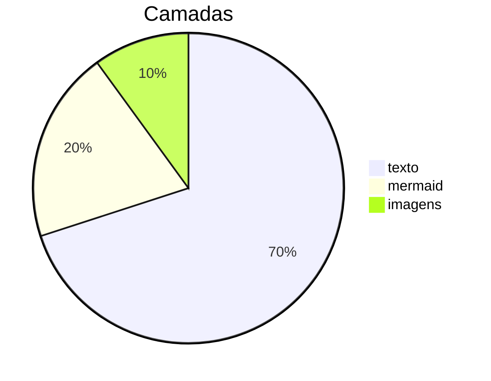
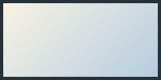

# Showcase do deckle

Este arquivo exercita todo tipo de bloco que o deckle sabe desenhar. Abra-o com
`:Deckle open` e role pelos dois lados: é o teste manual do plugin, e a suíte
(`tests/test_showcase.lua`) o renderiza a cada execução. A referência completa
está em `:help deckle` ([doc/deckle.txt](../doc/deckle.txt)).

## Títulos

# Nível 1
## Nível 2
### Nível 3
#### Nível 4
##### Nível 5
###### Nível 6

Título setext de nível 1
========================

Título setext de nível 2
------------------------

## Texto e ênfases

Um parágrafo com **negrito**, *itálico*, ***os dois juntos***, `código inline`, um
[link com texto](https://github.com/samuka7abr/deckle.nvim), um
[link de referência][ref] e um ~~tachado~~ que passa cru. A linha termina com uma
quebra forçada, e esta já é a seguinte.\
Uma barra invertida no fim da linha faz o mesmo. Escapes como \*isto\* ficam
como texto.

Wrap por largura de display: 日本語のテキストは空白なしで折り返され、絵文字 😀 や
👨‍👩‍👧 (uma sequência com ZWJ) nunca são partidos ao meio. Estreite a janela de
preview para ver as quebras mudarem. Uma palavra sem espaço maior que a janela:
https://example.com/um/caminho/muito/comprido/que/nao/cabe/em/janela/nenhuma/estreita.

[ref]: https://neovim.io

## Listas

- Um item simples
- Um item com **ênfase** e `código`
  - Segundo nível, com outro marcador
    - Terceiro nível, com o terceiro marcador
      - Quarto nível, que volta ao primeiro
- Um item com texto longo o bastante para quebrar em mais de uma linha, e a segunda
  linha alinha com o começo do texto, não com o marcador

1. Primeiro passo
2. Segundo passo
   1. Sub-passo a
   2. Sub-passo b
3. Terceiro passo

Uma lista que começa em oito, com os números alinhados à direita:

8. Oito
9. Nove
10. Dez

Tarefas:

- [x] Parser com treesitter
- [x] Render de texto, tabelas e código
- [ ] Mermaid no seu terminal
  - [x] Subtarefa feita
  - [ ] Subtarefa pendente

Item com mais de um parágrafo e um bloco de código:

- Primeiro parágrafo do item.

  Segundo parágrafo do mesmo item.

  ```lua
  print("código dentro de um item de lista")
  ```

- Outro item.

## Citações

> Uma citação simples, com texto longo o bastante para quebrar em mais de uma linha e
> mostrar que a borda continua em todas elas.
>
> Um segundo parágrafo na mesma citação.
>
> > Uma citação aninhada.
> >
> > > E mais uma dentro dela, com **ênfase**.
>
> - Uma lista dentro da citação
> - Com dois itens

## Tabelas

Alinhamentos à esquerda, ao centro e à direita (o cabeçalho segue o alinhamento):

| Esquerda | Centro | Direita |
|:---------|:------:|--------:|
| a        |   b    |       c |
| texto mais longo | meio | 1234 |
| `código` | **forte** | [link](https://neovim.io) |

Largura de display com CJK e emoji, que é o caso que desalinha quase toda
implementação:

| Idioma    | Saudação        | Bandeira |
|-----------|-----------------|:--------:|
| Português | Olá, mundo      | 🇧🇷       |
| Japonês   | こんにちは世界  | 🇯🇵       |
| Chinês    | 你好，世界      | 🇨🇳       |
| Coreano   | 안녕하세요      | 🇰🇷       |
| Emoji     | 👨‍👩‍👧 😀 ❤️        | ✨       |

Uma tabela mais larga que a janela tem as colunas largas truncadas com reticências:

| Coluna um com bastante texto | Coluna dois com ainda mais texto do que a primeira | Três |
|------------------------------|----------------------------------------------------|------|
| Um conteúdo bem comprido para forçar o truncamento | Outro conteúdo igualmente comprido, para testar o nivelamento | ok |

Células vazias e linha curta (completada com células vazias):

| A | B | C |
|---|---|---|
| 1 |   | 3 |
| só uma |

## Blocos de código

Com linguagem (colorido pelo parser do treesitter, se ele estiver instalado):

```lua
local function saudacao(nome)
  -- um comentário
  return ("olá, %s!"):format(nome or "mundo")
end

for i = 1, 3 do
  print(i, saudacao("deckle"))
end
```

```c
#include <stdio.h>

int main(void) {
    printf("olá, %s\n", "deckle");
    return 0;
}
```

Sem linguagem (moldura sem rótulo, sem cor):

```
$ nvim examples/showcase.md
:Deckle open
```

Com uma linguagem que não existe (moldura com rótulo, sem cor, sem erro):

```linguagem-inexistente
isto não tem parser nenhum
```

Uma linha de código mais larga que a janela não é quebrada: a janela de preview rola
na horizontal.

```lua
local muito_comprido = "esta linha de código é propositalmente longa para passar da largura de qualquer janela de preview razoável e mostrar a rolagem horizontal"
```

## Mermaid

Diagrama de sequência (camada 1, precisa do binário nativo; sem ele o bloco aparece
como código, com uma nota):



Fluxograma:



Um tipo que o renderer de texto não cobre (`pie`) degrada só esse bloco, para
código com uma nota; o resto do documento não muda:



## Imagens

Um parágrafo que é só uma imagem PNG local vira imagem de verdade em kitty e
ghostty (camada 2). Em qualquer outro terminal, aparece o texto alternativo:



Uma imagem no meio do texto, como esta  aqui, e uma imagem
remota, como esta:


continuam sendo texto alternativo em todos os terminais.

## Regra horizontal

Acima da regra.

---

Abaixo da regra.

## HTML

HTML não é interpretado: o bloco aparece como no fonte, em cor de comentário, para
nada sumir em silêncio.

<div align="center">
  <b>deckle.nvim</b> — preview de Markdown no Neovim
</div>

<!-- um comentário HTML também é um bloco -->

## Fim

Se tudo acima apareceu sem a linha `[deckle: could not render ... block]`, o render
está inteiro.
